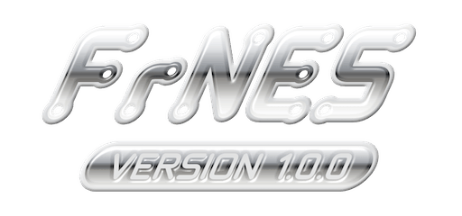
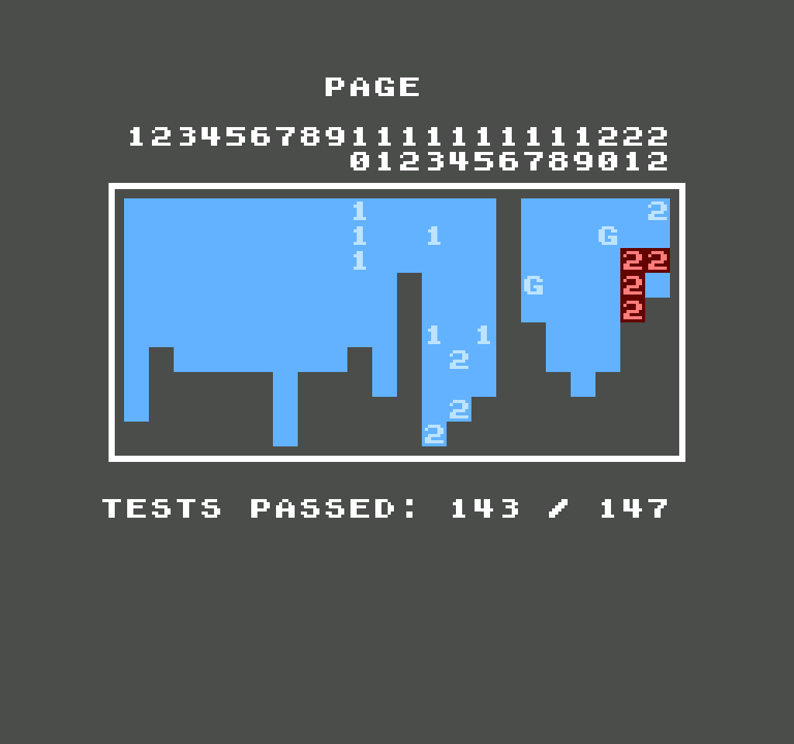
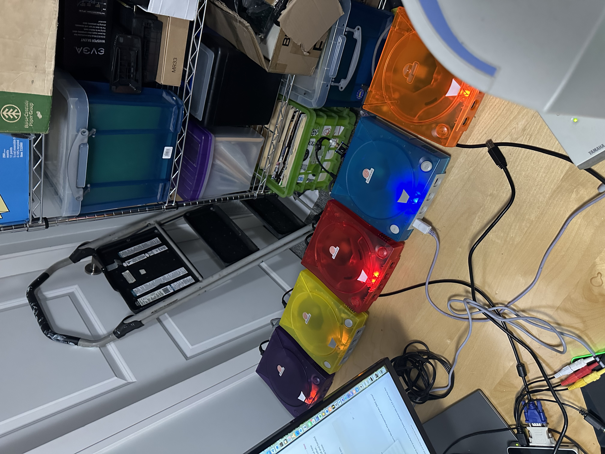

# FrNES 1.0.0

by [Matt Slevinsky](https://github.com/maslevin)

FrNES is an NES emulator for the Sega Dreamcast console. Version 1.0.0 is a complete rewrite: a cycle-accurate NES
(the 6502 CPU core written in SH4 assembly, with a C core beside it for testing), running at full speed, 60 frames a
second with no frame skipping, and sound at 44.1 kHz.

FrNES doesn't include any games: you need your own ROMs, and for Famicom Disk System games your own FDS BIOS
(`disksys.rom`).

[docs/how-to.md](docs/how-to.md) shows how to run it on a Dreamcast: from a burned CD-R or an ODE with your games on an
SD card, from a disc image of your own with your games on it, or loaded through dcload.

## Accuracy

FrNES passes 143 of the 147 tests in [AccuracyCoin](https://github.com/100thCoin/AccuracyCoin) (by Chris Siebert; its November 2026 version, master 66e87112) on a real Dreamcast.
The picture is the emulator's own frame, read back from the console.

## Features

- Nearly every licensed NES and Famicom board, the expansion audio chips, and most pirate and copier boards (what
  isn't supported yet, and why, is in [docs/compatibility.md](docs/compatibility.md))
- Famicom Disk System games, with the disks' written sides saved like battery saves; the right trigger flips the disk
- Vs. System games, with their coin slots and their own palettes
- NSF music player
- Four players: the NES Four Score and the Famicom's adapter
- The Zapper, aimed with a Dreamcast light gun (CRT TVs), the DC mouse or a controller; two Zappers in the games that
  have them
- The Arkanoid (Vaus) paddle, played with the DC mouse or a controller
- Battery saves and save states, on a VMU or an SD card
- Game Genie codes, typed in or chosen from the official code books' lists
- Movies: recording to an SD card, and playing FrNES (.frm) and BizHawk (.bk2) movies
- An in-game menu: save states, cheats, reset, the picture mode and smoothing
- Turbo buttons, and remappable controls for each port
- Picture modes (full screen, exact 2x, 8:7) and bilinear smoothing
- Box art and manuals for your games ([docs/box-art-and-manuals.md](docs/box-art-and-manuals.md))
- An SD card adapter for games, saves and movies

## Building

FrNES builds against mainline KallistiOS: see [docs/building.md](docs/building.md) for the KallistiOS version, the
patches in `tools/patches/` and the two recipes. `make frontend` builds FrNES with its menus, `make cdi` a bootable
disc image, `make release` (and `make cdi-player`) the stand-alone player, and `make debug` a debug build of it.

The emulator's sources are in `emulator/`, the menus in `frontend/`, and the build and layout tools in `tools/`; `make`
runs from the root.

## History

FrNES is an NES emulator for the Sega Dreamcast console.  It was based around Racoon's pNESx emulator for the original PlayStation.

In 2000, I had been working on a port of Hu-Go the PC Engine emulator to the Dreamcast and ran into a few issues with the port.  I found the pNESx source online and decided to take my working menu code from the Hu-Go port and hook it up to the pNESx emulator core.  The initial port took only a few hours to get running as the playstation code translated quite well to the libdream APIs which were available at the time.  A month or so later I released the emulator to the DC Scene and spent the next year or so improving elements of the emulator.  I added the Nofrendo sound code and implemented some of the more popular mappers, and called it quits after a Christmas release of the emulator in 2002.

In 2013 I decided to dig out the source code and try to build it against KOS 2.0.0.  Over the years I brought it up to date with modern KOS.  I also eventually incorporated the [VQFB technique](https://github.com/maslevin/dreamcast-samples/blob/master/vqfb/README.md) for rendering, 
better sound code, a more modern file browser and fixed a number of CPU opcode and address mode issues.  I released this updated version as version 0.7 on June 28, 2024.

In 2025 I started over as the inaccurate but fast nature of the old emulator design prevented many newer homebrews and a few notable commercial games from running properly. FrNES 1.0.0 is a complete rewrite. No code was copied from other emulators: the hardware was implemented from the nesdev wiki's documentation, with Mesen 2 and BizHawk used as references for testing. It has a cycle-accurate 6502 core in SH4 assembly and a cycle-accurate PPU, new sound at 44.1 kHz, the NES 2.0 database for every game's board, and new menus with an SD card browser, save states, movies, the Game Genie, box art and manuals. The emulator was redesigned to use the Dreamcast's MMU to manage NES memory space efficiently.

Through 2026 it grew to support nearly every board, the FDS, the Vs. System, the Four Score, the Zapper with the Dreamcast light gun and mouse, and the Arkanoid paddle, and it was tested against AccuracyCoin, BizHawk movies and recordings of real play. Claude was used to complete and optimize the cycle-accurate CPU and PPU cores and mapper implementations.  Claude was also used to iteratively generate an optimal binary release layout which was tested on hundred of games over a period of weeks using a cluster of 5 network controlled Dreamcasts.

Betas went out to a few testers from late October 2026, and in November 2026 FrNES moved to mainline KallistiOS for the 1.0.0 release.

## License

FrNES is released under the MIT License: see [LICENSE](LICENSE). The libraries it's built with keep their own
licences: see [docs/third-party-licenses.md](docs/third-party-licenses.md).

## Credits and Thanks

- [Racoon](https://archive.org/download/pNesX_aloha), for pNesX, the original NES emulator for the PlayStation, which
  kicked this whole project off so many years ago
- Megan Potter for starting [KallistiOS](https://github.com/KallistiOS/KallistiOS), and major thanks to all its
  contributors and maintainers that have kept it running over the years
- [Rand Linden](https://github.com/RandalLinden) for sharing his Dreamcast technical knowledge with me many years ago,
  and for Bleem!
- [Falco Girgis](https://github.com/gyrovorbis) for SH4ZAM and his major support, technical help and keeping attention
  on the Dreamcast scene
- [Paul Cercueil](https://github.com/pcercuei) for sharing his emulation ideas, especially for VQ multicodebook and for
  his work on Bloom
- [jnmartin84](https://github.com/jnmartin84) for sharing information on MMU usage
- M. Bibaud and the MesenCE team for [Mesen](https://www.mesen.ca), which was extremely helpful and influential in the
  development of FrNES 1.0.0
- BizHawk (NesHawk), used with Mesen 2 as an accuracy reference; NesHawk's power-on and reset timing is followed so
  BizHawk movies sync
- The [NESdev wiki](https://www.nesdev.org/wiki/) and its community, for the hardware's documentation and the 2C02G,
  2C07 and 2C03 palettes
- NewRisingSun, for the [NES 2.0 XML Database](https://forums.nesdev.org/viewtopic.php?t=19940), FrNES's game
  database (mappers, Vs. System settings and controllers), from which `mapper_table.h` and `prg_ram_table.h` were
  generated: boards, mirroring, battery and PRG RAM sizes for ROMs with iNES 1.0 headers
- The Game Genie codes: a compilation of Galoob's official NES code books, from
  [NES World](http://www.nesworld.com/gamegenie.php), and [GameGenie.com](https://gamegenie.com/cheats/gamegenie/nes/index.html)
- uthash / utarray by Troy D. Hanson (BSD license), in the menus
- [JetBrains Mono](https://www.jetbrains.com/lp/mono/), the list font, under the SIL Open Font License 1.1
- Neuropol, the title font, under CC0 1.0 (public domain dedication)

## Coding rules

- **Static tables and constants are `static const`**, with `FRNES_HOT_RODATA` (read while emulating: pinned in
  `.hotdata`) or `FRNES_COLD_RODATA` (read at ROM load only), both in `memory.h`. The generated tables are
  emitted that way. Writable data goes in `.data`, and `.bss` comes after `.data`; the hot buffers in `.bss` (the
  frame buffer, the APU log and ring, the VRC7 block) then move onto other operand cache sets, and the emulator gets
  measurably slower (1-1.6% for ~100 kB). `FRNES_COLD_RODATA` tables go last in `.rodata`, where their size moves no
  hot table, and new writable state that's only touched at load time or on rare events (a board's flags and
  registers, harness buffers) gets `FRNES_COLD_BSS`, which puts it last in `.bss`: nothing already in `.bss` moves. `tools/data_budget.py` fails the build when `.data` passes 16 kB.
- New board functions in `mapper.c` get `FRNES_BOARD_TEXT` (`memory.h`: linked after the library code, so a board
  growing moves none of KOS's per-frame code), and load-time code `FRNES_COLD_TEXT`: a change to a board or to
  load-time code should move none of the functions in ordinary `.text` (compare the builds' `map.txt`).
- No new `.bss` for board state: `_end` is the heap start, and moving it moves the ROM pages and sound buffers onto
  other cache sets. Keep a board's state on the heap (`board_state` in `mapper_boards.c`), and check `_end` against
  the base.
- Load time code that isn't hot belongs out of the link time optimized units where it can (`mapper_boards.c` and
  `fds.c` are built without LTO): small changes in the LTO units move the partitions, and the register allocation of
  hot functions in them (`mapper_ppu_clock` once grew 0x14 bytes from a mirroring choice at init).
